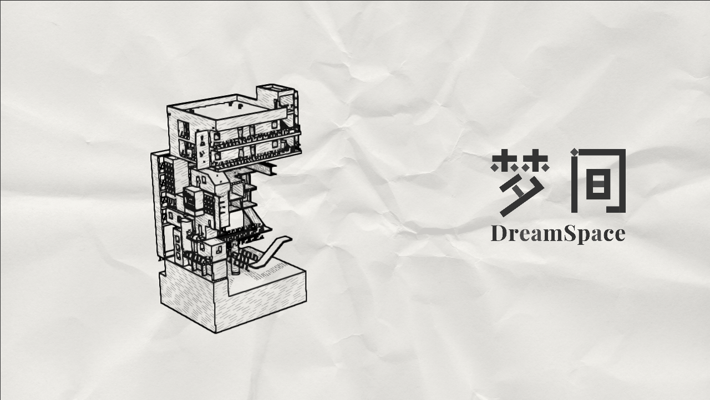
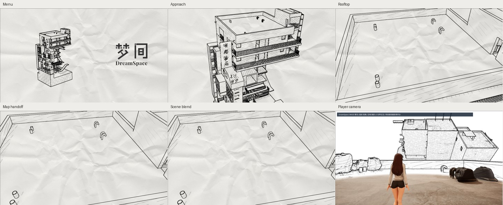

# 梦间开始界面

打开 `/Game/DreamPresentation/MainMenu/Maps/L_DreamMainMenu` 并运行即可查看。游戏默认启动地图和编辑器启动地图都已设为此关卡。左侧建筑以 **2°/秒**缓慢自转，右侧为保留原造型的石墨灰 Logo，背景为用户提供的浅皱 A4 纸。没有按钮或开始提示文字；点击画面任意位置，Logo 在 0.65 秒内退去，镜头用约 **3.8 秒**逐渐聚焦天台。Enter、空格、触摸和手柄底部确认键也可开始，Esc、滚轮和鼠标移动不会误触。

飞入时建筑平滑回到玩法地图的基准朝向，不会在点击瞬间或切图那一帧突然归零。天台最后一帧保留在视口中，加载 `/Game/0_/Maps/TEST` 后以 **0.55 秒**交叉淡化场景，再用 **1.75 秒**落到角色实际的越肩相机。纸纹渐隐、角色附近正常材质渐现，镜头完成后恢复输入与 HUD。加载仍采用 `OpenLevel`：加载期间天台画面会短暂保持，实际停留时间取决于设备和资源缓存。

菜单与 TEST 分别播放循环 BGM，确认开始时菜单音乐随 3.8 秒天台推进淡出，同时播放一次“请进入游戏”音效。短音效由 GameInstance 持有到自然结束。资源、音量配置和实机验证见 [BGM 与开始音效](DreamSpace_BGM与开始音效.md)。





## 结构与资源

菜单复制已保存的 `L_WhiteOutlinePreview` 中的 29 个可见网格和白材质覆盖。新关卡只有展示网格、灯光、后处理和菜单相机，不包含原关卡的机关逻辑。`TEST` 与原线稿／白盒预览仍使用各自的资源。

| 资源／代码 | 职责 |
| --- | --- |
| `ADreamMainMenuScene` | 建筑转轴、全周取景、动态排线坐标、从点击视点飞向天台与平滑归位 |
| `ADreamMainMenuGameMode` | 选择菜单控制器和相机，不生成 Pawn/HUD；继承预览的临时 FXAA 管理 |
| `ADreamMainMenuPlayerController` | 全屏 Slate 点击、Logo 退场、推进相机、一次性地图跳转 |
| `UDreamMenuTransitionSubsystem` | 跨地图视点和瞬时屏幕快照、交叉淡化、按实际渲染帧推进与资源清理 |
| `ADreamProximitySketchCameraManager` | 接到实际 Pawn POV，处理窗口 FOV 约定与纸纹／正常半径的恢复 |
| `Materials/M_MenuHatching`、`MI_MenuHatching` | 复制现有手绘效果，额外支持建筑局部排线坐标 |
| `Materials/M_MenuPaper`、`MI_MenuPaper` | 描边和平滑后统一叠加纸纹，白色建筑与空背景使用同一纸面 |
| `Textures/T_MenuLogo`、`T_MenuPaper` | 整理后的 Logo 和纸张，随关卡打包，无需外部素材文件 |
| `RawContent/MainMenu` | 整理后的 PNG 与来源记录，可用于重新导入 |

排线位置和投影法线会逆旋转到建筑的初始坐标，笔划跟随墙面，光照明暗仍使用世界法线。相机与转轴是兄弟组件，建筑旋转时相机固定。取景按包围盒旋转扫过的圆柱计算，窗口变化时重算相机距离和偏心布局；窄窗口自动改为 Logo 在上、建筑在下。

天台入口由真实 PlayerStart 和可调局部偏移计算，经过原建筑坐标系映射到菜单的当前姿态。推进从点击当帧的真实相机开始；终点与 TEST 采用相同世界位置、朝向和水平 FOV。游戏端从实际 `Pawn::CalcCamera` 读到目标，包含出生落地、肩位、避障、局部人物剔除及重力姿态。接管前吞探索按键、暂停输入映射安装，蓝图触摸移动／观察／跳跃入口也使用同一状态；直接 PIE TEST 没有菜单请求时正常游玩。失去 Pawn、外部镜头接管、控制器销毁、旅行失败或退出 PIE 均清理接力。

天台快照在 `OnViewportRendered` 通知场景已绘制后读取，随后由普通 Tick 安装持久 Slate 层，显示一帧再切图。TEST 首帧保持同一视点，等待实际渲染完成后才开始淡化；每次绘制只推进一次，单次长卡顿最多计入 0.1 秒，避免首次资源加载直接跳过入场动画。快照仅保存在内存中，淡化结束即释放。

## 调整

在关卡中选中 `MainMenu_BuildingAndCamera`：

| 属性 | 默认值 | 作用 |
| --- | --- | --- |
| `RotationSpeed` | 2°/秒 | 180 秒转一圈；0 停止、负数反向 |
| `bLogoOnRight` | true（当前关卡） | Logo 在右、建筑在左；窄窗口自动上下排列 |
| `BuildingHalfExtent` | 脚本记录的半尺寸 | 取景范围；更换建筑布局后应重新生成 |
| `LogoTexture` | `T_MenuLogo` | 更换透明 Logo |
| `GameplayBuildingTransform` | 原建筑中心坐标系 | 将 TEST 入口映射到菜单展示姿态 |
| `RooftopPlayerLocation` / `RooftopPlayerRotation` | TEST PlayerStart | 天台焦点与角色初始朝向 |
| `RooftopCameraOffset` | `(-750,-160,700)` cm | 相对角色初始朝向的入口相机偏移 |
| `RooftopFocusOffset` | `(120,0,-50)` cm | 相对 PlayerStart 的取景焦点偏移 |
| `RooftopFieldOfView` | 65° | 天台入口水平 FOV |

控制器默认属性：`RooftopApproachDuration=3.8`、`SceneFrameBlendDuration=0.55`、`PlayerLandingDuration=1.75`，单位为秒；`FadeOutDuration=0.65` 只控制 Logo 退出。

打开 `MI_MenuPaper` 可以覆盖 `PaperStrength`（默认 0.48）和 `PaperTint`（轻暖白），降低浓度可减弱褶皱。打开 `MI_MenuHatching` 可以调整与原预览相同的描边、排线和阴影参数。建筑局部坐标参数由运行时自动更新。

Logo 使用原透明轮廓，深色主笔与浅色装饰转换为接近的石墨灰。纸张选自 `M}CJ~C9~7K24I8~Q8YIME62.jpg`，旋转、裁切成横向并压低摄影阴影对比。所有新增代码、着色器和脚本包含中文说明。

## 重新生成

以下命令在项目根目录运行。普通 Python 需要 Pillow 和 NumPy；美术来源默认在项目旁边的 `_assets`，也可传 `--assets` 指定。脚本只写整理后的 PNG，不覆盖原图。

```powershell
python Source/MainMenu/prepare_main_menu_art.py
& 'E:\Epic Games\UE_5.8\Engine\Build\BatchFiles\Build.bat' DreamSpaceEditor Win64 Development `
  '-Project=F:\Ue5 Project\DreamSpace-UI\DreamSpace.uproject' -WaitMutex -NoHotReload
& 'E:\Epic Games\UE_5.8\Engine\Binaries\Win64\UnrealEditor-Cmd.exe' `
  'F:\Ue5 Project\DreamSpace-UI\DreamSpace.uproject' -run=pythonscript `
  '-script=F:/Ue5 Project/DreamSpace-UI/Source/MainMenu/generate_main_menu.py' `
  '-EnablePlugins=PythonScriptPlugin,EditorScriptingUtilities' `
  -unattended -AllowCommandletRendering -nosound
```

生成器读取已保存的白色预览，写入 `/Game/DreamPresentation/MainMenu`，重建菜单地图与专用材质。重新生成会覆盖菜单内的手动调整，先保留要继续使用的值。报告在 `Saved/MainMenu/generation_report.json`。`DefaultGame.ini` 明确将菜单和动态跳转目标 `TEST` 加入烘焙列表。

完整生成后，或策划调整 TEST 的 PlayerStart 后，运行增量同步脚本。它只保存菜单的天台参数和左右布局，要求 TEST 有唯一 PlayerStart，报告写入 `Saved/MainMenu/rooftop_sync.json`。

```powershell
& 'E:\Epic Games\UE_5.8\Engine\Binaries\Win64\UnrealEditor-Cmd.exe' `
  'F:\Ue5 Project\DreamSpace-UI\DreamSpace.uproject' -run=pythonscript `
  '-script=F:/Ue5 Project/DreamSpace-UI/Source/MainMenu/sync_menu_rooftop.py' `
  '-EnablePlugins=PythonScriptPlugin,EditorScriptingUtilities' -unattended -nullrhi -nosound
```

## 验收

```powershell
& 'E:\Epic Games\UE_5.8\Engine\Binaries\Win64\UnrealEditor.exe' `
  'F:\Ue5 Project\DreamSpace-UI\DreamSpace.uproject' `
  '-ExecutePythonScript=F:/Ue5 Project/DreamSpace-UI/Source/MainMenu/capture_main_menu.py' `
  '-EnablePlugins=PythonScriptPlugin,EditorScriptingUtilities' -unattended -nosound -NoSplash
```

这是独立验收编辑器，完成后自动退出。默认使用约 16:9 的新 PIE 窗口，临时窗口设置不写入用户配置；追加 `-DreamMenuEmbedded` 可检查编辑器嵌入式视口。脚本通过 Slate 命中检测在 `(0.96, 0.96)` 右下留白处模拟左键，以游戏时间采集推进、切图、落镜头关键帧与连续帧，并核对首帧天台对齐、终点实际 FollowCamera、FOV、线稿半径、门控、移动／观察／跳跃恢复、直接 TEST PIE 和抗锯齿恢复。

截图命令直接读取指定 PIE 视口并包含 Slate 快照层，避免切图时误截到编辑器视口。报告为 `Saved/MainMenu/capture_report.json`，截图同目录，连续帧位于 `TransitionFrames`。开发验收命令只编译进 `WITH_DEV_AUTOMATION_TESTS`，Shipping 不提供这些命令。

自动化套件 `DreamSpace.MainMenu` 包含五项测试：

- `CameraFitsFullRotation`：16:9、4:3、21:9、2:3 比例，左右两种布局，360° 每隔 5° 投影包围盒角点，确认全程在建筑区域内。
- `BuildingRotatesCameraStaysFixed`：瞬时世界内挂载实际子 Actor，30 秒转动 60°，同时检查相机变换没有随主体运动。
- `RooftopApproachAtAnyRotation`：0°／89°／179°／359°、16:9／21:9／2:3，点击起点不跳，窗口构图刷新不打断推进，终点与 TEST 取景和建筑朝向一致。
- `ArrivalProjectionMatchesPlayer`：使用引擎投影矩阵对比 MaintainXFOV／YFOV／MajorAxis 三种轴约定，接管时屏幕投影一致。
- `ArrivalLifecycleAndCleanup`：真实 GameInstance、控制器和相机验证跨世界隔离、首帧渲染等待、长卡顿与重复更新不跳过动画，以及失去角色／外部镜头／销毁中断清理。

## 验证记录

初版菜单于 2026-10-10 完成编译、旋转、材质和真实留白点击验收。2026-10-12 在 UE 5.8.2、Win64 Development 完成天台过渡的最终检查：

- `DreamSpaceEditor` 和 `DreamSpace` 两个目标编译通过，无 C++ 警告或错误。日志为 `Saved/Logs/TransitionBuildEditor.log`、`TransitionBuildGame.log`。
- 五项 MainMenu、一项 ProximitySketch、三项 WorldRecovery 自动化测试全部通过，共 9 项，0 警告、0 错误。报告为 `Saved/MainMenu/TransitionTests/index.json`。
- 实际渲染检查覆盖 1280×722 新窗口与 1602×571 嵌入式视口。菜单末帧到 TEST 首帧天台位置误差为 0 cm；到达玩家视角后位置、旋转、FOV 和线稿半径误差均为 0。两轮材质编译及全流程报告均无错误。
- 入场时探索输入被阻止，完成后移动、观察和跳跃恢复；新窗口测得移动 59.38 cm、观察 1.4°、跳跃高度变化 99.59 cm。直接运行 TEST 没有入场状态，抗锯齿由菜单 FXAA 恢复到 TEST 原设置。
- 新窗口加载约 1.53 秒，嵌入式约 1.52 秒；加载期间保持天台末帧。加载后入场实测约 2.86／3.11 游戏秒，受首帧等待和长卡顿保护影响，不会跳过配置的淡化与落镜头动画。
- 真实 AudioMixer 验收通过，涵盖循环、重复确认、音乐淡出、短音效自然结束、重启／中止清理和直接 TEST。详细记录见音频文档。

两种视口报告及截图分别保留在 `Saved/MainMenu/WindowCapture`、`EmbeddedCapture`；标准 `capture_report.json` 对应新窗口结果。`Saved/MainMenu/MenuToGameplay.gif` 是按游戏时间采样的画面预览，包含加载停留，并非实时录屏。

本次未制作完整打包产物。`TEST` 本身存在旧素材缺贴图／缺少部分嵌套蓝图的警告，菜单白材质覆盖不使用这些缺贴图材质。最终请在正常游戏窗口主观确认天台推进与落镜头节奏、加载停留的感受、纸纹浓度和 Logo／建筑的画面比例。
